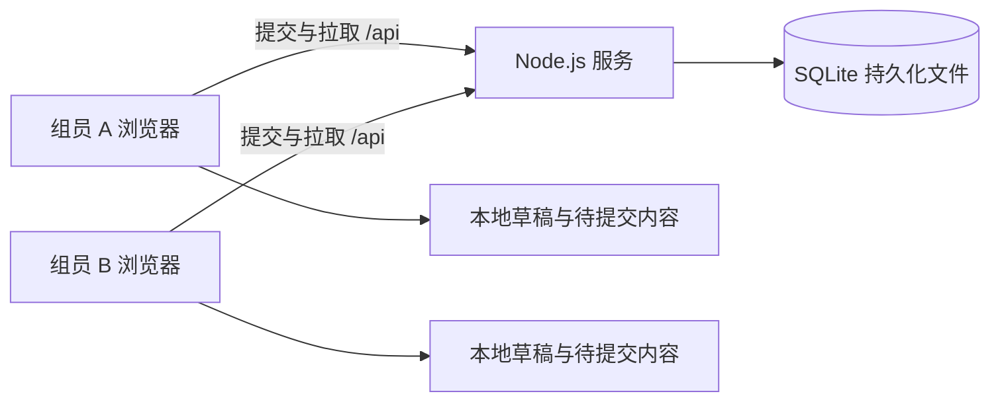

# 小组协作同步后端方案

状态：初版项目级方案留档。用户后续要求字段快照比较与数组直接合并，已按该规则实现；以下 API、表结构和同步协议不代表最终实现。实际运行方式与字段级协议见 [字段级后端使用说明](backend-sync-usage.md)。根据当前仓库于 2026-10-14 编写。

## 1. 推荐结论

最快可用的首版：**现有原生前端 + 单个 Node.js 服务 + SQLite + HTTP 保存 + 2–3 秒轮询 + 项目版本检查 + 完整快照历史**。

数据库不是实现同步的必要条件，服务端 JSON 文件也能实现。但本项目同时要求同步、记录、加载，建议直接使用 SQLite，让当前项目和修改历史在同一事务中落盘。无需部署 MySQL、PostgreSQL，也无需 ORM。

这里将“同步”定义为：组员在同一个项目中修改，其他成员通常在几秒内看到已提交的内容；并发冲突不会静默覆盖；刷新、换设备、后端重启后可以加载；能查看谁在什么时候提交了什么变化。首版不实现同一段文字的实时共同输入。

假设是一个小组、约 3–8 人、一个案例、一个后端实例、项目 JSON 不超过现有 5 MB 备份限制。人数只是设计假设，不是 SQLite 的容量上限。

## 2. 当前代码与需要解决的问题

| 当前实现 | 对同步的影响 |
| --- | --- |
| `src/js/core/store.js` 将完整 `state` 写入 localStorage，200 ms 防抖 | 可保留为本地草稿；不能把本地保存成功等同于后端保存成功 |
| `Store.add()` 根据本地 `counters` 生成 `ISS-001` 等编号 | 两个浏览器可能生成同一编号，在线新增必须由服务器分配 |
| `Store.update()` 增加记录 `version` | 已有复核依赖版本，可继续使用；与项目同步版本分开 |
| `core/review.js` 的复核指纹包含关联记录版本 | 加载远端内容后必须重新计算复核状态，不能沿用页面缓存 |
| `app.js` 路由切换直接写 `state.lastRoute` 并保存 | 导航是个人偏好，不能产生团队提交或改变别人的页面 |
| `markReviewed()` 直接修改 `state.reviewed` | 接入时不能只监听 `Store.update()`，否则会漏掉复核操作 |
| JSON 导入调用 `Store.replace()`，整份替换 | 在线模式必须走受版本保护的导入，不能直接上传覆盖团队状态 |
| 当前开发服务只监听 `127.0.0.1` | 其他设备无法访问；联机入口要监听可达地址 |
| 最终 `dist/index.html` 支持双击打开 | 联机模式应通过 HTTP 服务打开，使用同源 `/api` |

业务记录 `members`、`iterations` 是课程内容，不等于登录账户与系统修改日志。

## 3. 首版架构



后端同时提供前端静态文件与 `/api`，降低部署和跨域配置成本。数据库文件放在独立的 `data/` 目录，不能位于静态资源目录；服务只向浏览器返回业务数据。

后端是已提交内容的权威来源。localStorage 保存工作副本、未提交草稿、最近确认的服务端基线，仍提供断网保护和 JSON 导出。

后端采用 `node:http` 和 `node:sqlite` 即可，与现有项目保持无应用第三方依赖的方式。本机已检查为 Node.js `v24.11.1`，实际用 `DatabaseSync` 执行过内存 SQLite 查询，返回 SQLite `3.50.4`。当前 `package.json` 仍允许 Node.js 20，实施时需给后端明确 Node.js 24.x 的运行要求并固定部署版本。

该 Node 版本的 `node:sqlite` 仍处于实验阶段，会打印警告；应封装为独立存储模块，避免前端或业务逻辑依赖驱动细节。[对应版本官方文档](https://nodejs.org/download/release/v24.11.1/docs/api/sqlite.html)

## 4. 数据库是否必要

| 方案 | 优点 | 为满足本需求需要承担的工作 | 建议 |
| --- | --- | --- | --- |
| 内存 | 原型非常快 | 重启即丢数据，无法满足持久加载 | 仅用于测试 |
| 服务端 JSON 文件 | 无数据库驱动，容易查看 | 写入排队、临时文件替换、崩溃恢复、历史与当前状态的一致性均需自己处理 | 仅在明确拒绝数据库时采用 |
| SQLite | 单文件、无需数据库服务、有事务 | 少量 SQL、备份、持久化目录 | **首版推荐** |
| PostgreSQL / MySQL | 适合多个后端实例和更复杂的访问场景 | 安装或托管、连接管理、账号及迁移 | 目前没有足够需求支持这部分成本 |

SQLite 支持服务端应用，但同一数据库同一时刻只有一个写事务；小组低频提交可排队完成。若未来必须让多个后端实例共享数据，或实测写入排队成为瓶颈，再评估 PostgreSQL。[SQLite 官方适用场景](https://www.sqlite.org/whentouse.html)

如果选择 JSON 文件，至少把当前状态和全部历史放入同一个持久化对象，通过单进程写队列提交，成功落盘后才返回成功；另需验证目标系统上的替换与崩溃恢复行为。把 `current.json` 和 `history.json` 分别写入不能保证一次提交的一致性。

## 5. 保存什么

沿用 `schemaVersion: 1` 的业务数据，SQLite 内先保存完整 JSON，不把 15 类记录拆成 15 张表。拆表不会帮助当前首版尽快上线。

| 范围 | 字段 | 规则 |
| --- | --- | --- |
| 团队业务数据 | `meta`、`records`、`notes`、`stepData`、`focusId`、`focusAnalyses`、`reflections`、`reviewed` | 共享；`focusId` 是项目选定的分析焦点，不是个人正在浏览哪条记录 |
| 服务端派生数据 | `counters`、`updatedAt`、记录 `version` 与时间戳 | 服务端生成或校正，不采用客户端时钟判断先后 |
| 个人界面状态 | `lastRoute`、语言、主题、搜索、展开项、当前编辑记录 | 只存本地，不进入团队提交和历史差异 |
| 同步元数据 | `projectId`、`revision`、`requestId`、提交者 | 放在 API 信封和本地同步缓存，不塞进业务记录字段 |

服务端可以为备份兼容提供固定的 `lastRoute: "overview"`，客户端加载时保留个人路由。`revision` 是每次项目提交递增的整数；`records[].version` 是单条记录的内容版本，二者不能混用。

首版两张业务表足够：

```sql
CREATE TABLE projects (
  id TEXT PRIMARY KEY,
  revision INTEGER NOT NULL CHECK (revision >= 1),
  state_json TEXT NOT NULL,
  updated_at TEXT NOT NULL
);

CREATE TABLE revisions (
  project_id TEXT NOT NULL REFERENCES projects(id),
  revision INTEGER NOT NULL,
  request_id TEXT NOT NULL,
  request_hash TEXT NOT NULL,
  actor_id TEXT NOT NULL,
  actor_name TEXT NOT NULL,
  kind TEXT NOT NULL,
  summary_json TEXT NOT NULL,
  state_json TEXT NOT NULL,
  created_at TEXT NOT NULL,
  PRIMARY KEY (project_id, revision),
  UNIQUE (project_id, request_id)
);
```

项目初始化插入 revision 1 的完整快照。每次成功提交在同一事务内更新 `projects` 并插入 `revisions`。历史列表只取摘要与元数据，查看某个版本时才读完整快照。

`summary_json` 由服务器比较前后状态得到，例如“修改 FCT-003 的描述；复核步骤 3”；保存发生变化的字段及前后值，提交者来自访问令牌。首版将连续输入防抖合并为提交，不记录每个按键。

历史采用完整快照，避免为了加载某个版本重放所有操作。代价是空间随提交次数增长：100 KB 的项目，1,000 个版本约需 100 MB 快照空间，另有摘要和索引开销。实施时记录真实项目大小；接近 5 MB 的项目应尽早调整为定期快照加差异记录。首版保存全部历史，不静默清理。

## 6. 首版同步协议

### 6.1 加载与提交

1. 打开项目，通过 API 加载 `{ projectId, revision, state }`。将其记为已确认基线。
2. 输入立即更新前端工作副本，并按现有机制保存本地；独立设置远端状态为“待同步”。
3. 停止输入约 800–1,200 ms 后，发送 `{ baseRevision, requestId, state }`。同一个浏览器同一时刻只允许一个写请求在途。
4. 服务端先检查权限与幂等，再校验版本、数据及业务约束，使用事务保存状态与历史。提交成功后返回新的 `{ revision, state }`。
5. 客户端只确认此次请求发送的内容。在请求期间产生的新输入仍保留为待提交内容，不能被响应里的快照覆盖。

本地保存的 200 ms 定时器继续保留，远端上传单独防抖。导航、主题、语言改变不触发远端保存；业务内容没有变化的提交也不产生新版本。

客户端区分三个对象：最近确认的 `baseState`、此次发送的不可变 `sentState`、用户继续编辑的 `workingState`。响应到达后，以 `sentState` 到 `workingState` 的变化保留在途期间的输入，再叠加到服务端返回的规范状态；不能直接 `Store.replace(response.state)`。

### 6.2 获取其他成员修改

可见页面每 2–3 秒读取更新；请求完成后才安排下一次轮询，避免请求重叠。后台标签页降低频率，重新聚焦立即检查，网络失败采用退避。

- 本地无未提交内容、无写请求在途：发现更高 revision，加载服务端内容，更新本地基线，重新计算检查与复核状态。
- 本地有草稿或写请求在途：记录远端有更新，暂存最新快照；不覆盖工作副本，也不把新的 revision 配给旧的本地草稿。
- 保留正在编辑的控件、光标和输入法组合状态。远端更新可以延迟到输入暂停后渲染，避免输入中重建整个编辑区。

首版无需 WebSocket。以后若要求即时通知，可用 SSE 通知“项目版本已变化”，随后仍通过同一 GET 接口拉取；通知机制不能替代冲突检查。

### 6.3 并发冲突

首版采用**项目级乐观锁**：只有 `baseRevision` 与服务端当前 revision 相同才允许提交。

例如 A、B 都加载版本 12；A 成功提交版本 13；B 仍以 12 提交时收到 `409 REVISION_CONFLICT`。B 的草稿与已确认基线均保留，不能把它的 revision 直接改为 13 后自动重传整份状态。

首版冲突界面提供基线、本地、远端的差异。用户可逐项选择保留本地或远端内容，确认后以最新远端快照为基础形成新稿，再带最新 revision 提交；也可先导出本地草稿，放弃本次修改并加载最新内容。若解决期间又有远端提交，仍按同一规则拒绝过期保存。

**首版限制：即使两人改不同字段，也可能出现项目级冲突。** 这是缩短实现时间的取舍，适合先分工编辑、及时提交。若实际冲突频繁，下一阶段使用字段操作及目标旧值校验，自动接受互不相关的修改；同一字段仍人工处理，列表、多选和文本均不做未经确认的拼接。

### 6.4 新增、删除与记录版本

- 在线新增使用独立 POST，由服务器在事务内调用编号分配逻辑，返回 `ISS-002` 等最终编号；保留现有编号格式，兼容引用与 `parseBackup()`。
- 新增前先提交已有草稿；未解决冲突时暂停新增。创建请求在途时暂停依赖这次新增的编辑，成功后才创建关联和打开编辑面板。
- 在线模式断网时可继续编辑已有记录和写说明；首版不支持离线新增编号。这比引入临时编号及关联重映射更快。
- 服务端对真正变化的已有记录在当前版本基础上递增 `version`，不能相信客户端传来的版本数。对于本次新标记的复核，先确认其指纹匹配客户端提交的业务内容，再为最终规范状态计算指纹；既有复核不能因保存而自动重新确认，内容变化后仍保持“待复核”。在途期间新产生的复核也需要相同处理，避免服务端校正版本号后误判为失效。
- 归档、恢复和永久删除都进入历史。服务端同样检查引用、`focusId`、焦点历史，不能只依赖浏览器校验。
- 普通保存禁止自行新增编号、改类型、回退 `counters`；新增由 POST 负责，计数器按服务端已用最大值继续递增，不因恢复旧内容而重用编号。

## 7. 最小 API

默认项目可在首次启动时创建。所有业务接口均校验该项目的成员权限，API 路径中的项目 ID 不是访问凭证。

| 方法与路径 | 用途 | 关键约束 |
| --- | --- | --- |
| `GET /api/health` | 判断后端存活 | 不返回项目内容、令牌或配置 |
| `GET /api/projects/:id?ifRevision=12` | 加载当前项目或检查更新 | 相同版本返回 `204`；不同返回完整信封；禁用缓存 |
| `PUT /api/projects/:id` | 提交现有项目修改 | 必须携带 `baseRevision`、`requestId`、完整业务 `state` |
| `POST /api/projects/:id/records` | 在线新增记录并分配编号 | 携带版本、幂等 ID、`type`、`originStep`、初始 `data` |
| `GET /api/projects/:id/history?before=14&limit=30` | 分页查看提交历史 | 只返回摘要；服务端限制最大页长 |
| `GET /api/projects/:id/revisions/:revision` | 加载指定历史快照 | 默认只读预览，可导出 |
| `POST /api/projects/:id/restore` | 将历史内容恢复为一个新提交 | 管理成员操作；版本检查；不删除后续历史 |
| `POST /api/projects/:id/import` | 导入现有 JSON 备份 | 管理成员操作；版本检查；重建安全的计数与记录版本 |

写接口均使用同一套事务及幂等规则。请求成功但响应丢失时，以相同 `requestId` 和相同请求体重试，返回该次提交的结果，而不是再次新增记录。相同 ID 配不同内容返回明确错误。幂等检查必须早于版本检查，避免已成功的重试被当作过期提交。

服务端伪流程：

```text
校验成员权限、请求格式和体积
BEGIN IMMEDIATE
  按 projectId + requestId 查历史
  如已存在：校验请求哈希一致，返回当次结果，不再提交
  读取当前状态并检查 baseRevision
  执行业务操作，校验数据与引用，生成最终记录版本与时间
  重新校验复核指纹，生成差异摘要
  更新 projects 的 state 与 revision
  插入 revisions 的完整快照、作者、摘要、requestId 与哈希
COMMIT
返回成功结果
```

异常路径必须回滚。成功响应只在 COMMIT 后发出。冲突不创建版本，业务校验失败返回 `422`，体积超限返回 `413`，未认证或无权限分别返回 `401` / `403`。

恢复或导入必须维持项目 revision 单调递增；对于改变、重新出现的业务记录分配安全的新记录版本，未改变的记录不动。不能把历史 `record.version` 与旧 `reviewed` 指纹原样复制后视为已复核。导入与恢复后保留旧复核时间供查看，但不匹配的指纹自然进入待复核。

## 8. 修改记录与成员身份

首版每个组员一个随机访问令牌，后端私有配置保存令牌哈希、对应成员 ID、显示名、项目 ID 与是否有管理权限。前端输入令牌，以 `Authorization: Bearer ...` 访问；默认只在会话内保留，不写入 URL、项目备份或日志。

这样无需先开发注册、密码找回和账户管理页面，也能将提交与成员对应。令牌配置不提交 Git；日志作者由服务端身份映射产生，不能相信请求体里自报的姓名。若只使用一个共享口令加自填姓名，日志就只能作为自报贡献记录，不能可靠确认操作者。

历史应展示：服务器提交时间、成员、版本、变化摘要，以及变化前后内容。时间保存 UTC，界面按成员浏览器时区显示。系统日志与课程填写的“开发迭代”记录分别展示。

## 9. 断网、刷新与恢复

本地同步缓存按 `projectId` 命名，保存 `baseRevision`、`baseState`、`workingState` 和在途请求的 `requestId` / 请求体，避免切换项目串稿。

断网时显示“已保存本地，尚未同步”。浏览器刷新后先恢复未提交草稿，再查询服务端；不能直接用服务器覆盖恢复出来的草稿。重新联网若有结果未知的请求，先以原 ID 重试确认结果，之后再处理后续草稿或冲突。请求失败不丢草稿，也不把“已保存本地”显示为“已同步”。

同一设备多标签页也可能产生冲突；首版采用相同版本检查，每个标签页独立维护同步工作副本，可将持久草稿键细分到客户端实例，避免共享 localStorage 键互相覆盖。在线缓存恢复策略要与当前离线草稿键分开。

服务器重启读取同一 SQLite 文件即可恢复。部署时需要持久化磁盘；放在每次发布都会重建的临时目录，仍会丢数据。

备份是独立要求：每日生成一致的数据库备份，关键提交前再导出 JSON，至少保存一份在另一台设备或独立存储。运行中使用 SQLite 在线备份能力；如果启用 WAL，不能只复制主 `.sqlite` 文件就认为备份完整。应完成一次从备份恢复的演练。[SQLite 备份官方文档](https://www.sqlite.org/backup.html)

## 10. 接入现有代码

建议文件划分：

```text
server/
  index.mjs           HTTP 入口、静态文件、API 路由
  database.mjs        建表、事务、历史读写、备份
  project-service.mjs 业务校验、编号、版本、复核与摘要
  auth.mjs            私有成员令牌映射
src/js/core/
  sync.js             加载、上传、防抖、轮询、基线与重试
src/js/ui/
  collaboration.js    同步状态、冲突与历史界面
data/                 SQLite 与备份，加入 .gitignore
```

`server/` 不进入前端打包。后端可以复用 `parseBackup()`、记录类型、引用检查和复核纯函数，但 `parseBackup()` 目前主要检查备份结构，并不等于完整 API 验证；补充字段白名单、字段长度、真实引用与操作权限校验。HTTP 请求按实际字节数限流，保留业务备份 5 MB 限制并给信封少量余量；限制深度、记录数和提交频率。

接入点：

1. `Store` 保留本地保存接口，新增独立同步状态。监听业务变化或比较去除 UI 字段的业务快照，覆盖直接修改 `reviewed` 等路径。
2. 新增 `applyRemote()`，用于加载权威状态而不重新排队上传；不要沿用会调用 `save()` 并触发联机提交的普通 `replace()` 路径。
3. `app.js` 初始化时选择离线或联机模式。联机加载尊重恢复出来的草稿；导航只改变个人状态。
4. 在线 `addRecord()` 改为异步，等待服务器返回编号后继续关联创建；其他新增入口也一并调整。
5. 远端内容变化后清空 `ui.checks`，重算导航与复核，保持编辑上下文和输入法行为。
6. 在线导入、新建、恢复通过受保护的远端流程；离线版本继续使用现有本地流程。
7. 新状态文案加入中文与英文资源：待同步、同步中、已同步、离线、冲突、无权限。
8. 为后端增加单独的启动和语法检查入口；当前 `scripts/check.mjs` 只检查 `src/`，不会自动覆盖 `server/`。

## 11. 最快跑通顺序与验收

按端到端路径推进，先让两台设备保存与加载，再补历史界面。以下时间仅是熟悉现有代码、部署目标已确定时的粗略工程估算。

| 阶段 | 交付 | 粗略工作量 |
| --- | --- | --- |
| A：持久化链路 | 单服务、SQLite、成员令牌、初始项目、GET/PUT、事务、版本冲突与幂等 | 半天左右 |
| B：前端同步 | 联机加载、本地草稿、上传、轮询、异步新增、可操作的冲突提示 | 半天至一天 |
| C：历史与交付 | 历史查看、导入恢复、备份、跨设备及异常验证 | 半天左右 |

完整首版约 1–2 个工作日，复杂冲突交互或远程部署可能增加时间；“两个浏览器能看到同步”的演示可以更早完成，但不等于已经处理了丢数据风险。

首版验收必须覆盖：

- A 修改后，B 在可见页面轮询窗口内看到；B 刷新和服务器重启仍可加载。
- A、B 从同一版本保存，过期提交收到冲突，本地内容可查看、导出和解决。
- 保存响应到达前继续输入，新输入不被覆盖。
- 请求成功后断开响应，再用相同 ID 重试，不产生重复版本或重复编号。
- 两人新增记录，编号唯一且关联正确；断网新增入口给出明确状态。
- 断网编辑、刷新、重连后草稿仍在；多标签页不互相覆盖草稿。
- 修改被引用记录使相关步骤待复核；远端删除仍受引用保护。
- 历史能定位作者及变化；恢复产生新版本，旧历史保留，计数器不回退。
- 未授权成员无法读取、保存、查看历史；普通成员不能导入或恢复整份项目。
- 导航、主题、语言不产生团队版本；远端轮询不打断中文输入。
- 数据库备份能在新目录启动并恢复项目与历史。

现有 `npm run check` 和 `npm test` 在实施后继续执行，新增测试重点覆盖版本竞争、事务回滚、幂等、在途输入与断网恢复。

## 12. 部署选择与后续升级

**最快的首次演示**：一名组员的电脑运行服务，监听 `0.0.0.0`，同一可信局域网的成员访问 `http://该电脑局域网IP:端口`。其他成员不能访问主持机的 `127.0.0.1`。主持机需要保持开机，放行对应端口，并确认网络没有客户端隔离；这是持续协作的可用性限制。

**需要跨校园、跨网络长期使用**：将同一个服务部署到有持久化磁盘的单台主机，以 HTTPS 对外提供页面与 API。先确定主机与访问路径，再实施上线；不要直接把局域网 HTTP 服务暴露到公网。反向代理设置足够的请求体限制，数据库与私有配置不作为静态资源提供。

后续按实际问题升级：

1. 冲突频繁：从整份快照提交改成字段操作，服务端校验目标旧值；数据库仍可保存 JSON 快照，协议与存储不必同时重构。
2. 通知太慢：增加 SSE，重连后依据 revision 拉取补齐。
3. 必须离线新增：引入稳定 UUID，并将 `ISS-001` 变成显示编号，同时迁移备份、引用与验证规则。
4. 必须同时编辑一段文字：再评估 CRDT；它不替代作者记录、权限、业务引用和持久化。
5. 需要多个服务实例或实测高写入压力：迁移 PostgreSQL；保留 API 与客户端的版本约束。

本方案中的数据库选型解决持久化与事务一致性；版本协议、草稿保护及冲突处理解决同步正确性。两部分都需要实现。
