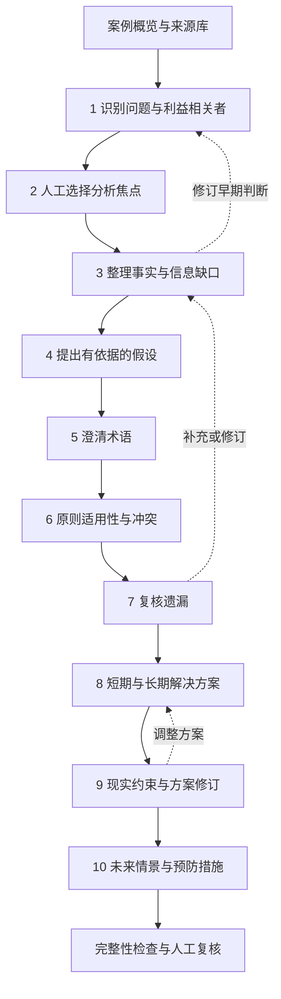

# HTML 10 步案例分析工具：交互设计方案

## 1. 设计范围与依据

本方案规划各板块的页面结构、输入内容、操作流程、检查规则和数据关联，供后续开发使用。本阶段只完成设计文档。

依据：[作业说明](../ref/assignment-description.txt)、[报告模板](../ref/Template_4.tex)、[项目任务清单](project-task-description.md)；案例背景参考 [挑战者号事故简介](../ref/case-description.txt)。另对照了仓库中的 [HTML 参考程序](../ref/NEW_case-analysis-tool-FULL-REFERENCE.html)，其可借鉴交互和与模板的差异见第 18 节。

**作业要求**：程序辅助组员自行分析，覆盖全部 10 步；课堂重点展示前 5 步；报告按模板自行撰写。

**本方案的设计选择**：采用中文界面加英文步骤名、一个案例工作区、逐步导航、结构化分析卡片、来源关联和人工复核。保存、导入导出、展示模式等是为了便于实际使用提出的功能，不是教师新增的硬性要求。

本轮已将范围明确的字段改为单选、多选和已有记录选择；开放分析采用“先选方向，再补具体说明”。完整选项、字段类型和条件展开规则见 [点选交互与选项清单](html-choice-interaction-design.md)。

配色、字体、布局、间距、组件和页面层级统一采用 [UI Design System](ui-design-system.md)。

以挑战者号事故作为初始案例背景，但所有分析记录默认空白。案例简介作为带来源标签的“背景材料”，不自动转成已核查事实、不预填最终分析结论。下文案例提示只是待讨论的问题，不是案例报告正文或已证实结论。课程完整伦理原则清单尚未提供，步骤 6 需由组员依据课程材料录入。

## 2. 整体使用体验

### 2.1 页面结构

桌面采用左侧导航、中央分析区、右侧参考区。屏幕较窄时，导航折叠为抽屉，参考区通过“查看关联材料”展开，中央编辑区保留完整宽度。

```text
┌──────────────────────────────────────────────────────────────┐
│ 案例名称 · 小组        保存状态    备份/导入    展示模式       │
├────────────┬─────────────────────────────┬───────────────────┤
│ 案例概览   │ 步骤编号、中英文名称         │ 关联材料          │
│ 01 伦理问题│ 本步目标、引导问题           │ 已选问题          │
│ 02 聚焦问题│                             │ 事实与假设        │
│ …          │ 本步骤专用工作区             │ 来源摘录          │
│ 10 未来问题│ 卡片 / 对比表 / 复核清单    │                   │
│            │                             │ 待补内容          │
│ 来源库     │ 本步重要性说明（按模板）     │ 具体缺项及跳转    │
│ 过程与反思 │                             │                   │
│ 完成检查   │ 上一步  检查本步  下一步    │                   │
└────────────┴─────────────────────────────┴───────────────────┘
```

“下一步”只切换页面，不表示本步完成；导航始终允许跨步骤跳转。步骤 3 的事实可能反过来修改步骤 1–2 的判断，步骤 9 的约束也可能要求返回步骤 8，不应强制单向填写。

### 2.2 推荐的操作路径

先录入案例和资料，再按 1–10 步展开分析。初次进入某一步时只展开最主要的输入区，详细关联和可选信息按需打开，避免一次呈现大量表单。



### 2.3 通用卡片交互

每条问题、事实、假设、术语、方案等都有稳定编号和标题。列表显示摘要，点击后在中央展开编辑，不为每个长文本反复弹出模态框。

| 操作 | 交互规则 |
| --- | --- |
| 新增 | 点击明确按钮，例如“新增伦理问题”；先显示最少字段，其余字段可展开 |
| 编辑 | 修改当前卡片；切换步骤保留内容；显示保存状态 |
| 添加关联 | 可搜索已有记录，显示编号、标题、所属步骤；选中后用标签呈现，可单独移除 |
| 查看关联 | 点击标签在参考区查看原记录；需要修改时跳转原步骤，提供返回当前位置的入口 |
| 归档 | 移出默认列表，保留历史和关联；提供撤销与查看归档入口 |
| 永久删除 | 只在归档管理中提供，显示影响到的记录；用户先处理关联，不能留下失效链接 |
| 检查 | 展示具体缺项及定位按钮，不用“输入不完整”这种无法行动的泛化提示 |

已关联的内容采用“引用同一条记录”，不复制成多个可独立修改的版本。标题修改同步到关联标签；内容变更后，引用该记录且已被人工复核的步骤显示“待复核”，保留原分析和复核记录，由组员确认是否需要调整。

### 2.4 状态与提示

| 状态 | 含义 | 用户如何处理 |
| --- | --- | --- |
| 未开始 | 没有输入实质内容 | 点击进入，按引导新增记录 |
| 进行中 | 有内容，但尚未通过完整性检查或尚未确认 | 补充缺项，检查本步 |
| 已复核 | 完整性检查通过，且组员手动确认已检查本步 | 后续仍可编辑 |
| 待复核 | 复核后本步或所引用材料发生变更 | 查看变更，重新检查并确认 |

**完整性检查只判断字段和关联是否齐全，不判断伦理结论是否正确。** 不提供道德分数、自动选题或自动决定方案。整体进度显示“已复核 4/10 步”，旁边显示待复核和未完成数量，不称为分析质量得分。

草稿保存和页面跳转不受缺项阻止；点击“标记已复核”时才检查必要信息。额外设计字段可以提示补充，但不能伪装成模板硬性要求。

第 1–3 步提供重要性说明输入框，无强制字数；第 4 步展示模板的目的说明，可补充个人备注；第 5–10 步提供重要性说明框并提示 50–100 words。英文显示按空白分隔的词数估算，中文显示字符数且提示计数口径待确认；混合文本也标明估算，不自动把汉字数当作 words，更不据此宣称报告达标。

### 2.5 优先点选，必要时补充说明

采用三种交互：固定分类或状态使用单选按钮；已有问题、事实、群体、来源和方案使用可搜索选择器；答案无法穷尽的原因、影响和措施类型使用候选多选加“其他，自行补充”。候选标签只是整理方向，不能代替案例结论。

同一字段通常先展示 4–6 个常用候选，更多内容可展开；少量固定选项直接平铺，不藏进下拉框。理由输入在用户作出相关选择后展开，首先提示“写明具体对象、行为或依据”，不先给一整页空白长文本框。

判断题不预选答案；“尚不确定”与空白不同，仍属于待研究。多选中的“无 / 不适用 / 尚不确定”与具体选项互斥。开放候选中的“其他”选中后展开短输入框；已有记录选择器永远提供“新增”入口，不能用候选列表限制可发现的问题或群体。

互斥条件分支切换时保留此前说明为暂存内容，只有当前分支对应的内容进入当前分析；用户重新切回可以恢复。普通多选标签变化时保留公用说明，提示用户检查是否需要调整，不按标签切换删除正文。检查仍需覆盖模板要求的人工说明，不能仅凭勾选数量标记已复核。选项说明、详细展开条件和导出规则以点选清单为准。

## 3. 步骤 1：识别伦理问题

**核心问题：这个案例中有哪些伦理问题，谁受到影响？**

### 页面与输入

中央上半部为“公司相关 / 工程师相关 / 其他”三类问题列表，下半部为利益相关者及影响表。分类使用标签切换，并始终显示各类条数，不要求每类必须凑足固定数量。

| 记录 | 模板所需字段 | 建议补充字段 |
| --- | --- | --- |
| 伦理问题 | 分类单选（公司 / 工程师 / 其他）、问题标题、问题描述 | 问题方向候选多选、相关利益相关者与来源选择；具体行为和价值冲突由组员说明 |
| 利益相关者 | 从常见群体中选择或自定义名称；影响类型候选多选 + 具体影响说明 | 关联问题多选、影响时间范围单选、来源选择或待核查状态 |
| 本步说明 | 为什么识别伦理问题重要 | 无 |

### 主要操作

1. 点击“新增伦理问题”，选择分类，填写标题和描述。
2. 点击“新增利益相关者”，选择群体名称或自定义，点选影响类型，再说明具体影响；未被选中的候选不创建分析记录。
3. 在问题卡片中关联一个或多个群体，右侧显示“问题—群体—影响”关系表。
4. 点击“检查本步”，查看遗漏；由组员决定是否补充或修订。

提供“区分技术现象与伦理问题”的折叠提示：技术现象描述发生了什么；伦理问题还应说明某个选择、责任、义务或利益冲突。提示不自动把现象改写成伦理结论。

**案例引导问题**：工程建议如何进入决策？安全责任由谁承担？不同群体承担的风险和获得的利益是否对等？

### 检查、关联与产物

- 检查标题、描述、分类和本步说明；至少记录 **3 类不同利益相关者**且分别说明影响。数量规则来自模板。
- 重复群体名称提示合并或说明差异，不通过重复新增同名项凑数。
- 输出问题清单及利益相关者影响表，供步骤 2 选题、步骤 6 原则关联和步骤 8 解决问题使用。
- 验收场景：新增问题后，在步骤 2 可以选择同一条问题；修改群体影响后，步骤 1 保留关系，并提示已引用它的相关步骤复核。

## 4. 步骤 2：缩小分析焦点

**核心问题：为什么优先深入分析这个问题？**

### 页面与输入

左侧为步骤 1 的候选问题列表，中间为可选的并排对比区，下方为重点问题的选择理由。最多同时对比 3 条只是界面容量，可替换候选项，不限制可分析的问题总数。

| 字段 | 交互方式 |
| --- | --- |
| 重点问题 | 从步骤 1 的未归档问题中单选，显示原描述和关联群体 |
| 与事件的因果关系 | 单选“直接 / 间接 / 尚不确定”，选择后说明依据；不确定状态提示补充事实 |
| 后果严重程度 | 先多选后果类型（人员、环境、财产、权利等），再说明具体后果与严重程度；标签不代替论证 |
| 后果影响范围 | 多选步骤 1 已有群体，必要时新增群体，再补充范围说明 |
| 短期后果 / 长期后果 | 两栏各先选后果类型，再补一句具体影响；每栏可选择“不适用”并说明原因 |
| 其他选择理由 | 多选常见理由或“其他”；“没有额外理由”与其余选项互斥 |
| 本步重要性说明 | 文本输入 |

### 主要操作

1. 从候选列表点击“加入对比”，人工填写比较理由，不产生综合评分或自动推荐。
2. 点击“设为分析焦点”，展示完整选择理由表。
3. 关联已有事实；尚未整理事实时，先保存判断，之后从步骤 3 回来核查。
4. 更换焦点时保留原问题的理由记录，并提示步骤 3–6 中与焦点有关的分析需检查。

**案例引导问题**：当前焦点是技术风险判断、信息沟通、管理决策，还是其他问题？选择依据是什么？

### 检查、关联与产物

- 检查选中问题存在，因果理由、严重程度、范围、长短期后果及本步说明已填写；“尚不确定”的因果关系保留为待研究，不标记为已复核。
- 若步骤 1 暂无问题，显示“先到步骤 1 新增问题”，保留本步其他草稿。
- 输出由组员选定的焦点及理由，不删除其他问题；步骤 8 仍可处理全部问题。
- 验收场景：更换焦点后，新旧问题的已写理由均保留，原事实和方案不会被清空。

## 5. 步骤 3：确定相关事实与缺失事实

**核心问题：哪些内容有依据，哪些仍不知道？**

### 页面与输入

使用“一般事实 / 物质与技术事实 / 个人相关 / 组织相关 / 缺失事实”五个分类页签；另提供按时间排序的只读视图。默认使用列表，时间线是辅助查看方式。

| 记录 | 必备输入 | 建议补充 |
| --- | --- | --- |
| 一般事实 | 日期、地点、其他相关事实；确实未知时明确标为未知 | 来源、关联问题 |
| 其他事实 | 分类单选、事实陈述 | 日期控件、来源多选及页码/章节、核查状态单选、关联问题多选 |
| 缺失事实 | 缺失方向候选多选 + 具体缺失内容及说明 | 重要性说明、计划寻找的资料、负责人从成员选择、调查进展单选 |
| 本步说明 | 为什么区分相关与缺失事实重要 | 无 |

核查状态为“未核查 / 已核查 / 存在争议”。带来源不等于已核查；勾选“已核查”要求组员确认来源确实支持这条陈述。没有来源的记录可以保存，但会提示补证。

### 主要操作

1. 点击“记录事实”，选择分类，填写陈述并关联来源。
2. 点击“记录信息缺口”，写出缺什么以及为什么影响分析。
3. 选中两条可能冲突的事实，点击“标记存在争议”，由组员描述差异；程序不裁定哪个正确。
4. 缺失信息得到补充时，点击“补充为事实”，创建事实记录并关联原缺口，原缺口标为已补充，保留变化过程。
5. 对未解决缺口点击“到步骤 4 建立假设”，带入记录链接和问题标题，不填入假设答案。

**案例引导问题**：当时有哪些可用的风险资料？谁在什么时间知道哪些信息？哪些表述来自材料，哪些只是后来的解释？

### 检查、关联与产物

- 检查一般事实和本步说明；其他各分类填写记录，或由组员明确记录“本次未发现相关事实”及说明，不强迫捏造内容。
- 未核查、无来源和存在争议的事实在侧栏集中列出；没有缺失事实时要记录人工检查后的说明。
- 输出分类事实清单、来源关联和信息缺口清单，供步骤 4、6、7 等引用。
- 验收场景：缺口被补充后，步骤 4 的相关假设显示“依据有更新”，不被自动改成事实或删除。

## 6. 步骤 4：提出合理假设

**核心问题：信息不足时，可以基于什么作出暂时推断？**

### 页面与输入

左侧列出步骤 3 的信息缺口，中央为“问题 → 假设 → 理由”卡片，右侧显示依据与可能受影响的判断。假设使用明确文字标签，与事实保持视觉区别。

| 字段 | 交互方式 |
| --- | --- |
| 对应缺失事实 | 从步骤 3 选择；新发现缺口可先保存草稿，再跳转登记 |
| 为此提出的问题 | 人工填写；可从缺口标题复制后编辑 |
| 合理假设 | 人工填写陈述 |
| 作出假设的理由 | 先多选“已有事实 / 专业经验 / 逻辑推断 / 其他”，再说明具体推理；已有事实从记录中选择 |
| 依据和影响 | 关联事实、来源、问题或方案，属于建议字段 |
| 反向情形 | 可选：如果假设不成立，会如何改变判断？ |
| 状态 | 单选“暂时采用 / 待核查 / 已被证据否定 / 已由事实替代”；否定或替代时选择新证据 |

### 主要操作

1. 选中一个缺口，点击“为该缺口新增假设”。
2. 填写问题、假设与依据；可为同一个缺口建立不同假设，人工注明当前采用哪一条及理由。
3. 可点击“比较相反假设”，并排显示两种推断及各自影响，帮助检查判断是否过于依赖单一假设。
4. 当出现新证据时，组员更新假设状态；“由事实替代”需链接步骤 3 的新事实，不自动将原推断改名为事实。

**案例引导问题**：缺少某项当时的记录时，你们准备暂时假设什么？如果这个假设相反，责任判断或建议会变吗？

### 检查、关联与产物

- 每条采用的假设需有问题、陈述、理由和已登记缺口；这些是本方案的结构完整性规则。
- 已否定或被替代的假设保持可追溯，但默认不列入当前采用清单；如果有方案仍依赖它，显示待复核提示。
- 没有需要采用的假设时允许填写理由，不强制编造假设凑数。
- 输出假设清单及依据；本步重要性说明不设模板之外的字数要求。
- 验收场景：改变假设状态后，所关联方案显示待复核，方案正文保持原样。

## 7. 步骤 5：澄清定义

**核心问题：关键术语在本案例中究竟是什么意思？**

### 页面与输入

中央为术语卡片，右侧为“出现位置与相关材料”。每张卡片按“定义 → 澄清 → 案例相关性”固定顺序展示。

| 字段 | 交互方式 |
| --- | --- |
| 术语 | 常见术语候选选择或自定义，支持中英文名称；不预填定义 |
| 定义 | 人工录入，并可关联定义来源 |
| 澄清说明 | 先多选“含义歧义 / 适用范围 / 近义概念 / 角色差异 / 文化语境 / 其他”，再说明本案例的具体区别 |
| 不同理解与采用理由 | 可选：记录不同角色或文化情境下的理解，由组员说明本次采用的含义，不按国籍预设立场 |
| 与案例的相关性 | 说明该术语如何影响问题分析或判断 |
| 出现位置 | 可关联问题、事实、假设等记录 |
| 本步重要性说明 | 提示 50–100 words |

### 主要操作

1. 点击“新增术语”，人工选择需要澄清的概念。
2. 填写定义、澄清和相关性，选取来源。
3. 在关联选择器中勾选使用该术语的记录；点击关联可查看上下文。
4. 对相近术语可“并排比较”，由组员填入区别；重复名称提示合并或说明不同含义。

**案例引导方向**：可以考虑是否需要澄清工程风险、专业责任、可接受风险等概念。工具仅列为可选讨论方向，不预填定义，也不预选为本案例的最终术语。

### 检查、关联与产物

- 至少 **3 个不同术语**，每个具备定义、澄清与相关性；数量要求来自模板。
- 检查重要性说明；无定义来源提供补证建议，不能通过联网自动填入未经确认的释义。
- 输出术语表，供后续原则分析及报告自行写作时查阅。
- 验收场景：第三条术语字段未齐时，提示具体缺失字段，而不是只按卡片数量显示达标。

## 8. 步骤 6：应用伦理原则

**核心问题：课程中的哪些原则适用，它们如何发生冲突？**

### 页面与输入

分为“课程原则清单”“适用性分析”“冲突与处理”三个区域。原则清单必须显示来源版本，不能用通用伦理原则冒充课程规定清单。

| 记录 | 字段 |
| --- | --- |
| 原则原文 | 初始化时录入课程编号、名称、原文和出处；分析时从课程清单选择，避免重复输入 |
| 原则分析 | 适用 / 不纳入 / 待讨论单选；对应问题和证据多选；仍需适用或排除理由 |
| 冲突记录 | 先选择“发现冲突 / 经检查未发现 / 尚不确定”；发现时选择冲突对象与处理方向，再说明具体冲突、取舍和理由 |
| 本步说明 | 50–100 words 的重要性说明 |

### 主要操作

1. 首次进入时，提示“请依据课程材料录入完整原则清单”；允许先保存分析草稿。
2. 逐条选择状态：“适用”展开适用理由，“不纳入”展开排除理由，“待讨论”记录争议。
3. 在原则卡片中点击“记录冲突”，选择至少两个冲突对象并解释冲突。
4. 若某方是商业利益等诉求，用“其他利益诉求”单独标识，避免将其误称为课程伦理原则。
5. 将组员的处理方式关联到相关问题，后续在步骤 8 选择方案时查看。

**案例引导问题**：哪些课程原则与该决策有关？某个组织目标与原则是否冲突？你们凭什么判断应优先满足某项义务？

### 检查、关联与产物

- 课程清单未录入或尚未确认完整时，不能宣称已检查全部原则。
- 每条原则须有人工作出适用性选择并说明理由；待讨论项保留为未完成。
- 冲突记录须说明冲突与处理方式；若组员未发现冲突，应记录已检查的范围和理由，不能只留空。
- 输出适用原则、排除理由及冲突处理表；不对原则自动赋权，也不自动裁定优先级。
- 验收场景：选择“不纳入”后，该原则仍出现在排除理由列表中，不消失；原则原文修改后，相应分析提示复核。

## 9. 步骤 7：复核分析

**核心问题：前面遗漏了什么，哪些判断需要重新检查？**

### 页面与输入

中央为复核清单和“新增发现”列表；右侧汇总前 6 步的缺项、未核查资料、争议事实和依赖假设。程序汇总的是已记录的状态，不自动判断案例中还有哪些伦理问题。

复核提示围绕五个方向：利益相关者是否遗漏、事实与假设是否混淆、术语是否有歧义、原则冲突是否充分讨论、是否存在不同解释或反例。

| 字段 | 交互方式 |
| --- | --- |
| 遗漏要素标题与描述 | 人工填写新增发现 |
| 类型 | 单选“新问题 / 新事实 / 新缺口 / 假设修订 / 术语补充 / 原则分析修订 / 其他” |
| 影响位置 | 关联应复核的已有记录 |
| 后续行动 | 多选“补资料 / 核查来源 / 修订分析 / 新增问题 / 形成方案 / 其他”，选择目标记录或补简短行动说明 |
| 处理状态 | 单选“待处理 / 处理中 / 已处理 / 暂不处理”；后两项展开结果或理由 |
| 本步重要性说明 | 提示 50–100 words |

### 主要操作

1. 点击复核提示，各项单选“发现需处理事项 / 经检查未发现 / 尚未检查”；发现事项时展开遗漏记录，未发现时按复核方向记录必要依据。
2. 点击“记录遗漏要素”，填写发现与影响位置。
3. 对新伦理问题点击“登记为新增问题”，保存到问题清单，来源标记为“步骤 7 复核发现”；步骤 8 将它列在新增问题区。
4. 对新事实或缺口点击“到步骤 3 补充”，创建关联记录；返回时保留原复核发现。
5. 更新行动状态；若未发现新要素，记录复核范围及理由，而不是自动填“无”。

### 检查、关联与产物

- 检查复核范围、本步说明和发现记录的标题与描述；未处理行动单独提示，不强制全部在本步解决。
- 已处理的发现必须有处理说明或关联结果，避免只勾状态而没有行动记录。
- 输出遗漏要素和处理清单，支持回到前面步骤，并把新增伦理问题传递到步骤 8。
- 验收场景：同一复核发现重复点击“登记”只打开已关联问题，不生成多条重复问题。

## 10. 步骤 8：解决伦理问题

**核心问题：针对这些问题，短期和长期分别应做什么？**

### 页面与输入

问题列表分为“步骤 1 识别的问题”和“步骤 7 复核新增的问题”。选中问题后，中央并列呈现短期与长期方案；可展开多套候选方案比较。

| 字段 | 模板所需或设计用途 |
| --- | --- |
| 所针对问题 | 必须关联问题清单中的记录 |
| 短期解决方案 | 先多选行动方向（暂停或限制 / 补证 / 沟通 / 保护措施 / 其他），再填写具体行动；方向本身不是方案 |
| 长期解决方案 | 先多选改进方向（工程设计 / 审查制度 / 信息沟通 / 培训 / 监督问责 / 其他），再说明具体改进 |
| 依据与理由 | 建议关联事实、假设、原则及冲突处理 |
| 实施信息 | 责任主体从已登记成员、群体或组织选择，可新增；预期效果、代价和副作用按需说明 |
| 小组选择 | 单选“候选 / 拟采用 / 暂不采用”；后两项填写选择理由 |
| 本步重要性说明 | 提示 50–100 words |

### 主要操作

1. 选中问题，点击“为该问题新增方案”，短期和长期分别先点选方向，再填写具体行动。
2. 需要讨论替代方案时，点击“新增候选方案”，人工比较受益群体、代价、原则依据和依赖条件。
3. 点击“标为拟采用”，填写选择理由；同一问题可采用多项互补方案，由组员解释配合方式。
4. 点击“查看问题覆盖”，看到已有方案、尚未处理和明确暂缓的问题。
5. 步骤 9 有约束反馈时，在原方案中修改并保留简短修订说明。

**案例引导问题**：若站在当时的决策时点，应采取什么近期行动？如何改变信息沟通、风险审查或决策机制，才能长期降低同类问题？这些都需组员自行论证。

### 检查、关联与产物

- 每条进入当前方案清单的记录需有对应问题、短期方案和长期方案。
- 检查原始问题和复核新增问题均已被查看；没有方案的问题提示补充，或人工写明暂缓原因。
- 允许记录某一时间尺度暂不适用的理由，不用空泛句子填满字段。
- 输出两类问题的短期与长期方案，以及人工选择理由；不自动输出“最佳方案”。
- 验收场景：步骤 7 新增的问题出现在新增区，并且可以创建方案；步骤 2 没选为焦点的问题同样可以处理。

## 11. 步骤 9：识别现实约束

**核心问题：方案落地受哪些条件限制，需要怎样调整？**

### 页面与输入

上部为“技术与工程 / 监管与法律 / 文化环境 / 其他”四类约束，下部为“约束—方案”影响表。选择某条约束时，在右侧查看所关联方案及依据。

| 字段 | 交互方式 |
| --- | --- |
| 约束类别、名称、描述 | 类别单选；约束方向候选多选；仍填写具体名称和描述 |
| 对案例的重要性 | 解释它为何影响现实选择，模板要求 |
| 依据与适用情境 | 可关联来源；法律条目建议记录适用地域与时间 |
| 受影响方案 | 从步骤 8 多选；也可标为案例整体约束并说明 |
| 影响与应对 | 先多选“增加成本 / 延迟实施 / 限制可行性 / 要求补证 / 其他”，再说明调整；应对状态单选“待处理 / 正在应对 / 已缓解 / 暂时接受” |
| 本步重要性说明 | 提示 50–100 words |

### 主要操作

1. 点击某分类的“新增约束”，填写名称、描述与重要性。
2. 关联受影响的方案，人工说明阻碍及可能调整。
3. 点击“到步骤 8 修订方案”，在原方案中修改；约束记录保留关联，不生成另一个失联方案副本。
4. 返回步骤 9，记录约束是否已被缓解、仍待处理或只能接受，并解释理由。

**案例引导问题**：某项改进在当时受到怎样的工程条件、权限或组织文化限制？你们是在描述历史条件，还是提出今天适用的建议？

### 检查、关联与产物

- 每条约束需要类别、名称、描述与重要性；四类均应查看，没有相关约束时由组员注明理由。
- 未关联方案不阻止保存：有些约束针对案例整体；涉及具体方案而尚未说明影响时提示补充。
- 工具不自行宣称某方案违法或技术上不可行，这些判断需用户提供依据。
- 输出分类约束表和方案调整记录；返回步骤 8 修改后，本步相关分析显示待复核，由用户确认。
- 验收场景：一条约束可影响多个方案；修订方案后，原约束与问题的关联继续存在。

## 12. 步骤 10：预测并避免未来伦理问题

**核心问题：未来出现不同条件时，还会产生哪些新的伦理风险？**

### 页面与输入

以“未来情景 → 新问题 → 预防措施”为主线，每张卡片展示一个情景。输入区并列呈现工程与设计、政府与法律、其他措施三栏。

| 字段 | 模板所需或设计用途 |
| --- | --- |
| 未来情景 | 先多选变化方向（技术能力 / 自动化 / 应用规模 / 参与主体 / 制度环境 / 其他），再描述具体情景；时间范围可单选或自定义 |
| 新伦理问题与描述 | 模板要求；强调此前尚未明确讨论的问题 |
| 与已有问题的区别 | 建议选择相关历史问题并解释新增之处 |
| 受影响群体与触发条件 | 群体从已有记录多选，可新增；触发条件仍需具体说明 |
| 工程与设计措施 | 从工程措施方向多选，再说明具体措施；不适用时说明理由 |
| 政府与法律措施 | 从治理措施方向多选，再说明具体措施；不适用时说明理由 |
| 其他可能措施 | 组织、教育、公众沟通等候选多选，或选择“无额外措施”；选了方向需补具体内容 |
| 本步重要性说明 | 提示 50–100 words |

### 主要操作

1. 点击“新增未来情景”，点选变化方向并说明改变了什么，不把历史事实直接标为预测。
2. 提出可能的新问题，查看已有问题清单并解释差异。
3. 分别录入预防措施；可关联前面方案和约束，检查新措施是否重复或依赖未成立条件。
4. 可选填写监测信号、责任主体和触发行动，让预防措施更便于后续讨论。

**案例引导问题**：如果未来航天任务的运营方式、自动化程度或参与主体发生变化，会出现哪些新的责任或风险沟通问题？此处属于情景构想，不能写成已经发生的事实。

### 检查、关联与产物

- 检查新问题、描述、工程与设计措施、政府与法律措施及本步说明；某类措施不适用时要求组员说明原因。
- 已有同名问题只做重复提示，不自动判断情景是否创新；是否存在新问题由组员复核。
- 输出未来伦理问题及多层预防措施表，不预测事故概率或声称风险已消除。
- 验收场景：引用既有问题不会改写其历史记录；新情景明确标为未来假设情境。

## 13. 支撑板块

### 13.1 案例概览

录入案例名称、小组编号、成员、报告日期、一般背景、时间线和案例介绍。成员贡献通过手动填写汇总，操作记录只作为参考，不自动计算贡献比例。

案例介绍提示“不超过 100 words”；简介原文单独放在背景材料区，标记其来源和待核查状态。首页提供“继续上次编辑”和全部 10 步的状态概览。

### 13.2 来源库

每条来源可记录作者、年份、标题、文献类型、出版信息、DOI/URL、页码或章节、人工核查状态和 APA 7 引用文本。添加来源后可关联事实、术语、原则等记录，点击来源能看到使用位置。

来源类型区分课程材料、案例背景、科学文献和其他资料；“报告参考文献至少 10 条”只统计去重后被组员标记为拟用于报告的科学文献候选，仍提示人工确认适用性与格式。工具中的引用链接不等于报告正文已引用，另外保留“已在报告正文引用”的手动检查项。

来源用途类别、文献类型、核查状态均用单选；关联位置用已有记录多选。作者、题名、DOI、页码、引用文本仍按材料录入。成员、记录负责人及截图对应的迭代会话从已有清单选择，减少重复输入姓名和编号。

提供“未关联来源”“尚未在报告引用”“待核查”筛选；不得根据有 DOI 或链接就自动宣称文献可靠。APA 7 格式、排序及引用完整性由组员最终核对。

### 13.3 过程与反思

用简短迭代记录保存日期、参与成员、AI 工具、提示目的、试用问题、修改结果和截图文件索引。提供“记录未经核查接受的内容”入口，保存代码位置或文案、当时接受原因和后续核查情况，供反思使用。

为 3 个反思问题提供组员自行输入的笔记框，提示每题 150 words；不生成回答。截图仍需从实际会话采集，程序内的迭代记录和截图索引不替代所有 AI 交互截图的提交。

首版仅保存截图文件名与说明，截图文件另外整理；工具明确显示“仅登记索引”，避免让用户以为已经把截图备份进项目。

### 13.4 完成检查与展示

完成检查按报告模板分组显示：案例介绍、10 步、利益相关者、术语、重要性说明、反思、贡献与 AI statement、科学文献。显示“字段完整性”和“人工核查状态”两列，不把保存成功当作作业完成。

展示模式隐藏编辑控件、放大已填写的标题与关键卡片，并提供“前 5 步”快捷导航。所有 10 步仍可查看；用户自行选取展示记录，不自动总结分析结论，也不替代单独制作 PPT。

## 14. 保存、备份与关联更新

### 14.1 保存与恢复

首版按单人操作、多人轮流编辑设计；小组交换同一份项目备份，不假设浏览器本地文件可以实时同步。

- 内容变更后自动尝试本地保存，页面显示“正在保存 / 已保存及时间 / 保存失败”。本地保存仅表示当前浏览器保存，不表示已写回 HTML 文件。
- 提供显式“导出项目备份”，包含全部结构化输入、来源、关联、归档项和复核状态；截图索引不包含实际图片。
- 在浏览器存储不可用或写入失败时保留当前内存内容，显示导出备份入口；首版需在直接打开本地 HTML 的实际环境验证保存与恢复。
- 新建案例前提醒导出当前案例；旧案例在明确确认替换前保留。
- 导入先检查文件格式与字段结构，再展示案例名、备份时间和条目数量。首版采用整份替换，不自动合并不同组员的项目；覆盖前提供当前项目备份。
- 导出阅读笔记可作为可选后续功能，只组织已有人工输入，不生成报告正文。

### 14.2 数据关联与更新规则

| 记录 | 主关联关系 |
| --- | --- |
| 问题 | 来源步骤、利益相关者、支撑事实 |
| 焦点选择 | 选中问题、选择理由、支撑事实 |
| 事实与缺口 | 来源、相关问题、缺口补充记录 |
| 假设 | 信息缺口、支撑事实、受影响问题或方案 |
| 术语 | 定义来源、相关记录 |
| 原则分析 | 课程原则、问题、事实/假设、冲突 |
| 复核发现 | 影响记录、生成的新记录、行动状态 |
| 方案 | 原始/新增问题、依据、现实约束 |
| 约束 | 分类、相关方案、调整记录 |
| 未来情景 | 历史问题、新伦理问题、措施、现实约束 |

通过稳定编号关联记录，标题只是展示名称。人工确认复核时记录当前关联内容版本；引用内容变化后，按版本差异提示复核，不自动覆写分析正文。方案与约束的双向关系只表示各自需要检查，不能触发反复自动修改；用户确认时更新该步骤的复核记录。

归档的引用保留“已归档”标记，不能作为当前有效内容悄悄消失。导入缺失关联时显示具体损坏位置并要求处理，不能只按编号猜测对应项。

## 15. 可用性与交互文案

- 状态同时用文字和图标表达，不只依赖颜色；事实、假设、未来情景的类型标签始终可见。
- 所有表单有可见标签，必填说明不只放在占位文字中；键盘可访问导航、卡片、关联选择和提示。
- 检查失败后先显示缺项列表，点击可聚焦对应字段；关闭弹层后焦点返回原触发按钮。
- 长文本输入不随检查弹出而清空；切换步骤、展开参考材料和进入展示模式不丢失草稿。
- 避免频繁成功弹窗，保存状态放在顶部；归档、备份、导入使用清楚的结果提示。

| 场景 | 建议文案 |
| --- | --- |
| 步骤 1 群体不足 | “已填写 2 类利益相关者；模板要求至少 3 类，并说明各自受到的影响。” |
| 步骤 3 无来源 | “这条陈述尚未关联来源。可以保留草稿，核查后再确认。” |
| 步骤 4 依据更新 | “该信息缺口已有新事实，请检查原假设是否仍适用。” |
| 步骤 6 清单缺失 | “请先依据课程材料录入完整原则清单，再检查适用与排除理由。” |
| 步骤 8 缺长期方案 | “此问题已有短期行动，请补充长期方案，或说明长期方案不适用的原因。” |
| 上游内容变化 | “你引用的材料已修改。查看变化后，确认本步分析是否需要调整。” |
| 保存失败 | “当前内容尚未保存到浏览器。请先导出项目备份。” |

## 16. 首版范围与后续增强

优先保证完整 10 步可用，每一步都有本方案规定的主要输入与操作；不能先把前 5 步做完整、后 5 步只放静态介绍。

| 优先级 | 功能范围 | 原因 |
| --- | --- | --- |
| 首版核心 | 案例概览、10 步导航、结构化记录、模板检查、跨步骤关联、人工复核、来源库 | 完成完整案例分析的基本路径 |
| 首版核心 | 自动保存状态、项目备份导入导出、归档恢复、依赖更新提示 | 保留小组工作并避免材料变更后继续沿用旧判断 |
| 首版核心 | 基本展示模式、前 5 步快捷导航、过程与反思笔记、截图索引 | 支持课堂展示和开发过程整理 |
| 后续增强 | 事实时间线、相反假设对比、多方案对比、完整关系图、编辑版本对比 | 提升讨论效率；首版可先使用列表和来源摘要 |
| 后续增强 | 多案例管理、多人在线协作、截图附件存储、阅读笔记导出 | 需要额外设计与验证，待核心功能稳定后考虑 |

## 17. 后续实现时的人工验收场景

以下是用于验证交互设计是否落地的检查场景，本阶段不编写测试代码。

1. 从空案例开始，完成问题、焦点、事实、假设、术语、原则、复核、方案、约束和未来情景，所有记录均可编辑并保存。
2. 第 1 步少于 3 类利益相关者、第 5 步少于 3 个完整术语时，准确提示模板缺项；第 7–10 步不误设“至少 3 项”。
3. 未补齐字段仍可保存和跳转，只有“标记已复核”需要完成相应检查。
4. 修改步骤 3 事实后，受影响的已复核假设或方案提示复核，但任何人工文字都不被自动改写。
5. 步骤 7 登记新问题后，步骤 8 新增问题区出现该问题；重复操作不会生成重复记录。
6. 步骤 9 修改约束并返回步骤 8 修订方案后，双向关联保持完整，复核提示不会反复自动触发修改。
7. 归档被引用的记录后，引用处可查看归档内容并显示状态；恢复后原关联仍然有效。
8. 导出备份并在另一浏览器导入，输入内容、关联、状态与归档项恢复一致；截图仍提示需另带实际文件。
9. 模拟存储失败、错误导入文件和存在失效引用的备份，给出明确提示并保留当前工作。
10. 直接打开本地 HTML 的目标设备上可使用核心路径，窄屏和键盘操作可完成新增、编辑、跳转与备份。
11. 展示模式可从前 5 步切换到后 5 步，不改变编辑数据，不生成结论。
12. 无课程原则清单、无文献核查或中文计数口径未确定时，界面准确表达未完成或需人工确认，不宣称报告已经达标。
13. 单选最多选一项；多选中的“无 / 不适用 / 尚不确定”与具体候选互斥，选“其他”需补内容，必需判断不被默认代选。
14. 已有记录选择器支持新增与去重；只勾选群体候选但未补具体影响，不计入已完成的 3 类群体；术语同理仍需定义、澄清和相关性。
15. 切换选项不会删除已写说明；备份包含选项、用户补充和暂存分支，阅读笔记只显示当前有效内容，不把标签自动扩写成报告文字。

开始开发前，仍需补齐课程伦理原则清单和教材方法细节，并确认报告语言及字数口径。上述信息尚未补齐时，页面可保留空白输入和清楚的材料提示，不填入推测内容。

## 18. 与仓库参考程序的对照

逐项源码检查、导出流程及边界行为详见 [参考程序交互对比与报告导出逻辑检查](reference-interaction-comparison.md)。

参考程序提供了引导语、分析视角切换、文化语境术语卡片和步骤 7 的缺口提示，适合作为交互灵感。本方案以作业说明与报告模板作为内容验收依据，不能只复制参考程序中的较简化表单。

| 参考程序中的设计 | 本方案的处理 |
| --- | --- |
| 步骤 1 提示争取列出 3–5 个问题 | 可作为探索提示；不将其设为模板硬性门槛。模板明确的数量要求是至少 3 类利益相关者 |
| 步骤 3 主要提供三类事实及缺失事实 | 补齐模板中的一般事实、日期和地点，以及来源与核查状态 |
| 步骤 5 给价值相关术语呈现不同理解 | 允许用户填写不同理解及采用理由；仍要求至少 3 个完整术语，不局限于参考程序内置的四个词 |
| 步骤 6 主要填写原则与冲突 | 增加完整课程清单、逐项适用判断和排除理由，满足报告结构 |
| 步骤 7 主要汇总前文并用规则提示缺口 | 保留具体缺项提示，同时增加遗漏要素、行动和新增问题登记，支持模板要求 |
| 步骤 8 主要回答聚焦问题与理由 | 覆盖原始及复核新增的多个问题，分别提供短期、长期方案 |
| 步骤 10 主要回看历史上可提前避免问题的节点 | 历史预防思考可作为辅助提示；主界面按模板要求设计为未来的新伦理问题及多类预防措施 |
| 可切换提问语气与分析视角 | 作为后续增强，默认采用提问式引导；视角只改变显示的讨论问题，不改写用户数据、不自动确定原则优先级 |
| 部分反馈基于字数或关键词规则 | 本方案明确区分字段检查与伦理判断，不把简短文字或关键词命中直接判为分析质量差 |
| 案例开场含特定宿主环境的在线 AI 请求 | 首版采用人工录入背景及引导问题，不依赖该宿主环境；任何以后新增的在线辅助需单独规划 |

若后续增加视角切换，可提供“公共安全 / 个体权利 / 组织关系”等讨论视角，并显示当前视角及其强调的方面。切换仅更新引导问题，既有结论由组员自行重新审视；记录视角变化及讨论理由，也能为 AI 参与设计和道德推理的反思提供材料。
