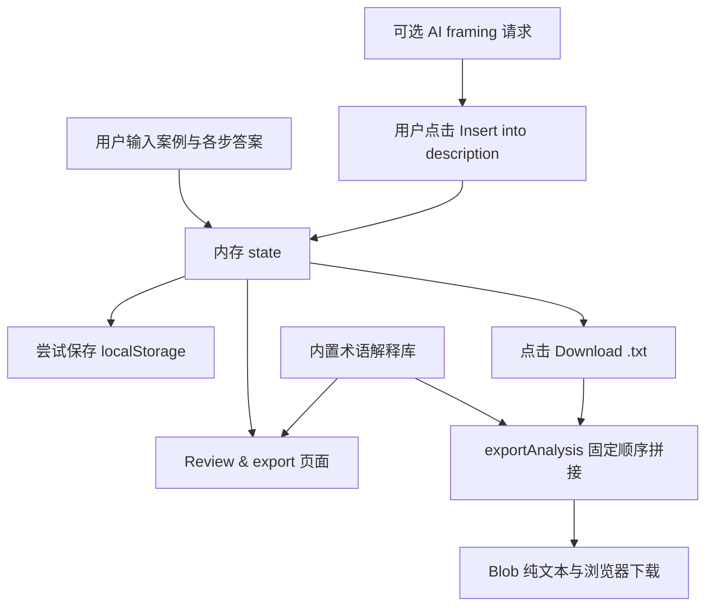

# 参考 HTML 交互对比与报告导出逻辑检查

检查对象：[参考程序](../ref/NEW_case-analysis-tool-FULL-REFERENCE.html)、[当前交互设计](html-interaction-design.md)、[报告模板](../ref/Template_4.tex)。

本次检查阅读了页面结构、交互绑定、状态保存、规则反馈、汇总与导出代码，并在模拟 DOM 环境中执行原文件的相关函数核验边界行为。没有修改参考 HTML，没有开始编写项目 HTML；没有运行真实浏览器界面或实际调用外部 AI 服务。下文“当前设计”均指文档中的规划，不表示功能已经实现。

## 1. 主要结论

参考程序采用 **逐步自由文本填写 + 引导反思 + 最后汇集为 TXT** 的交互方式。当前设计采用 **结构化记录 + 跨步骤关联 + 模板完整性检查 + 人工复核**，更便于覆盖报告要求，但界面与开发复杂度也更高。

参考程序中用户所说的 report 对应 `Review & export` 页面和 `Download .txt` 按钮。**点击导出时不调用 AI：程序按固定结构拼接已有答案，并下载纯文本文件。** 它没有自动撰写报告正文，也没有按 LaTeX 模板生成 `.tex` 或 PDF。

不过，导出文件并非全部来自用户原创输入：步骤 5 会加入程序内置的术语解释；若用户之前把 AI framing 插入案例简介，这部分 AI 文字也会随简介进入导出。

## 2. 参考程序如何交互

### 2.1 页面与导航

- 桌面是两栏：280px 左侧导航 + 右侧单一填写区，没有右侧来源/关联材料栏。
- 左侧显示案例名、当前设置、10 步导航，以及工具设置、文化语境、汇总导出、全部重置按钮。
- 中央按当前页面显示标题、引导语、附加提示、文本框和前后切换按钮。
- 所有步骤都可直接点击，无填写完成门槛；切换页面会保存状态并滚动回顶部。
- 设置与文化语境页面是辅助页面，返回按钮回到之前的主要内容页面。
- 小于 820px 时变为单列，侧栏排在正文上方，并非可折叠抽屉。
- 视觉采用米色背景、深绿色重点色、细边框和大标题，适合阅读；引用了外部 Google Fonts，正文另有系统字体后备。

代码依据：参考 HTML 第 103、141、265、716、800、834 行附近。

### 2.2 三组设置

| 设置 | 可选项 | 实际影响 |
| --- | --- | --- |
| Authority mode | Socratic / Balanced / Directive，共 3 种 | 改变固定反思反馈、文化术语卡片提问和步骤 7 提示的语气；不改用户答案 |
| Analytical lens | None / 公共安全 / 个体权利与同意 / 群体地位与关系 | 在步骤 1、3、6、8 替换视角引导文案；不重新推理、排序或修改答案 |
| Context of use | 课堂 / 设计前研究 / 政策监管 / 事故后复核 | 在步骤 1、3、8、9、10 替换用途引导文案；不改变字段结构或导出格式 |

这些设置呈现工具的价值取向，能帮助讨论“设计怎样影响推理”。但其实现主要是选择不同固定字符串，不是三套不同分析算法。

代码依据：`AUTHORITY_DEFS` 第 339 行、`LENS_DEFS` 第 361 行附近、`USE_CONTEXTS` 第 401 行附近，及第 990、1128 行附近。

### 2.3 反思按钮不是实时 AI

`Reflect on this answer` 出现在步骤 1 的两个输入框、步骤 6 的冲突、步骤 8 的论证和步骤 9 的约束，共 5 个位置。

点击后调用 `getCannedFeedback()`，根据是否为空、字符长度、非空行数和英文关键词，从内置句子中选取反馈。例如“简短”的条件为非空且长度小于 40，步骤 7 冲突检查的条件为长度小于 15；它们不是报告的 words 计数。

反馈只写入当前页面的提示元素，不写入 `state.responses`，所以不会进入导出文件；页面重新渲染后也不会作为历史反馈自动恢复。

中文输入未包含预设英文关键词时，某些涉及利益相关者或文化术语的提示不能正确适用。规则不能判断内容是否准确、深入或合理。

代码依据：第 610、1158、1230 行附近。

### 2.4 步骤 5 和步骤 7 的特殊交互

**步骤 5**：扫描指定输入框是否包含与 loyalty、consent、authority/hierarchy、whistleblowing/dissent 有关的英文词片段。命中后显示两种固定理解和一个个人反思框；另保留一般术语文本框。

其所谓“扫描步骤 1–4”实际只读取步骤 1 的问题/群体、步骤 3 的技术/个人/组织事实，以及步骤 4 的假设。**步骤 2 的输入和步骤 3 的缺失事实没有被扫描。**

**步骤 7**：不提供新的输入框，只显示六类规则检查结果及前面普通输入框的只读回顾。检查包括问题行数不足、部分事实类别为空、缺失事实未填写、有缺失事实但假设为空、冲突文字过短、使用术语却未澄清。

文化术语的步骤 7 检查又使用另一组扫描输入，包含步骤 6，但不包含步骤 2、4；因此它与步骤 5 的命中范围并不完全一致。回顾也不展示步骤 5 动态卡片内的反思，只回顾固定 prompts。

代码依据：第 485、493、506、531、1139、1174 行附近。

## 3. 与当前总体设计的比较

| 方面 | 参考程序实际实现 | 当前设计文档 | 判断与建议 |
| --- | --- | --- | --- |
| 主界面 | 左导航 + 自由文本填写 | 左导航 + 专用工作区 + 参考区 | 可借鉴参考程序的简洁阅读风格，参考区默认按需展开 |
| 输入模型 | 每个步骤几段长文本 | 问题、事实、假设、方案等多条记录 | 当前设计能建立关联；新增时先只显示核心字段 |
| 进入成本 | 少量字段，上手快 | 字段、状态与关联较多 | 首版优先完成一条分析记录，再引导补来源或关联 |
| 自由跳转 | 全部步骤可跳转 | 全部步骤可跳转 | 保持一致，不强制单向流程 |
| 完成提示 | 任一字段有非空内容即显示 done 样式 | 未开始 / 进行中 / 已复核 / 待复核 | 采用当前设计；有内容不等于完成或正确 |
| 指导风格 | 3 种 Authority mode | 默认提问式，切换为后续增强 | 可借鉴提问式；规则反馈不应假装在评价道德推理 |
| 分析视角 | 3 种 lens + None，4 种用途 | 视角为后续增强，课堂为主要用途 | 适合展示创造性，但先完成课程必需输入 |
| 跨步关联 | 主要是读取长文本、关键词匹配和回顾 | 明确关联记录，变更后提示复核 | 当前设计更适合追踪依据和修订 |
| 文献与来源 | 无来源库、引用管理 | 来源库、核查状态、引用位置 | 当前设计应保留，支撑报告至少 10 条科学文献 |
| 保存 | 每次输入尝试 localStorage，失败只记控制台 | 可见保存状态与失败提示 | 采用当前设计，避免用户误以为保存成功 |
| 备份 | 仅导出 TXT，无导入入口 | 项目备份导入导出 | TXT 用来阅读，结构化备份用于恢复，应分开 |
| 历史与归档 | 无版本、归档、变化追踪 | 归档恢复、变更复核 | 可先做简洁修订说明，不必一开始开发完整历史对比 |
| 课堂展示 | 沿用填写页面 | 独立只读展示模式，前 5 步快捷导航 | 当前设计更适合演示，不替代 PPT |
| 反思 | 一个关于 10 步流程调整的框架反思 | 作业要求的 3 个问题及迭代笔记 | 保留当前设计的 3 题；框架反思可选追加 |
| AI | 开场 framing 请求；其他反馈为固定规则 | 首版采用人工输入和预设引导问题 | 不需要把在线 AI 作为导出或课堂演示的依赖 |

当前设计里“阅读笔记导出”列为后续增强；参考程序则把 TXT 导出放在主要流程。若后续希望每次分析结束都能拿走材料，可把“原样导出分析笔记”提升为首版功能，但这只是本次建议，尚未修改既有优先级。

## 4. 逐步比较

| 步骤 | 参考程序的交互 | 当前设计的主要增加或调整 |
| --- | --- | --- |
| 1 识别伦理问题 | 问题列表、受影响群体两个长文本框；建议 3–5 个问题 | 公司/工程师/其他问题分类，独立群体记录和具体影响，至少 3 类群体检查；问题条数建议不作为模板硬门槛 |
| 2 缩小焦点 | 手动重新写重点问题和理由 | 从问题记录中选择，避免重写失联；明确因果、严重度、范围、长短期后果；保留焦点切换记录 |
| 3 确定事实 | 技术、个人、组织、缺失事实四框 | 加一般事实及日期地点，来源与人工核查，独立缺口记录和补充路径 |
| 4 合理假设 | 一个“假设及理由”长文本框 | 缺口—问题—假设—依据对应，区分采用、待核查、否定和被事实替代 |
| 5 澄清定义 | 一般术语框 + 英文关键词触发的固定卡片 | 至少 3 个完整术语，每项有定义、澄清、相关性；允许人工增加任何术语和不同理解 |
| 6 伦理分析 | 相关原则、冲突两个文本框 | 完整课程原则清单，适用与排除理由，冲突对象和解决理由 |
| 7 复核 | 缺口规则提示和前文回顾，无录入 | 人工遗漏发现、行动状态、修订入口及新增问题登记，形成可写入报告的复核记录 |
| 8 解决问题 | 对重点问题的结论和论证 | 原始问题与复核新增问题分别覆盖，短期与长期方案，人工比较候选方案 |
| 9 现实约束 | 一个自由文本框 | 技术/法律/文化/其他分类，每项重要性，关联方案并返回修订 |
| 10 避免伦理问题 | 回顾历史上哪些更早行动能避免问题 | 按模板提出未来可能的新问题，以及工程设计、政府法律和其他预防措施 |

整体上，参考程序适合作为讨论引导示例，直接照搬会漏掉模板所需的细分内容，尤其是步骤 7、8、10。

## 5. report 的完整生成链路

### 5.1 数据从哪里来

`freshState()` 初始化案例标题、简介、各步骤答案、框架反思及三组设置。普通输入通过 `setResponse(stepKey, promptId, value)` 存入 `state.responses`；案例简介和末尾反思有各自的输入绑定。

图中汇总页只显示命中术语的反思答案，不显示两种内置解释；TXT 导出才把两种解释也加入。导出主要读取当前内存中的 `state`，并不是在下载时重新从 localStorage 读取文件。

代码依据：第 679、704、1024、1213、1275 行附近。

### 5.2 汇总页面怎么构建

`renderSummaryScreen()` 遍历 `STEP_DEFS`：

1. 对每个固定问题读取答案，未填写显示 `Not answered yet.`。
2. 在步骤 5 额外读取当前被关键词命中的文化术语反思。
3. 没有可展示字段的步骤直接返回空字符串，所以 **步骤 7 被省略**。
4. 追加一个 `FRAMEWORK REFLECTION` 输入框，询问小组对流程有哪些删减、重排、合并或新增。
5. 放置 `Download .txt` 按钮，绑定 `exportAnalysis()`。

中央汇总页没有另行显示案例简介；案例名仍在左侧导航，TXT 才同时包含案例标题和简介。因此汇总页与下载内容并不完全一致。

代码依据：第 1239–1276 行。

### 5.3 TXT 导出到底做什么

`exportAnalysis()` 的顺序如下：

| 顺序 | 写入内容 | 来源 |
| --- | --- | --- |
| 1 | `CASE ANALYSIS` 与分隔线 | 固定字符串 |
| 2 | 案例标题；非空时加入简介 | `state.caseTitle`、`state.caseDescription` |
| 3 | 用途、Authority mode、Analytical lens | 导出时当前设置的显示名称 |
| 4 | STEP 1–10 标题、各固定问题及答案 | `STEP_DEFS` + `state.responses` |
| 5 | 无输入项的步骤写占位说明 | 步骤 7 写 `(review step — no separate entry)` |
| 6 | 步骤 5 命中的术语、两种固定理解、用户反思 | 当前关键词检测 + 内置词库 + 对应答案 |
| 7 | `FRAMEWORK REFLECTION` 与回答 | `state.reflection` |
| 8 | 换行连接为纯文本，下载 | `Blob`、`URL.createObjectURL()`、临时 `<a>` |

导出没有调用 `fetch()` 或模型，也没有归纳、改写、补全、检查事实、生成参考文献、转换 LaTeX 或排版 PDF。未填答案用 `(no answer)` 占位，仍然允许下载。

文件名由案例标题转小写，再删除/替换非 ASCII 字母数字为连字符，最后附加 `.txt`。空标题用 `case-analysis`；但非空纯中文标题在清洗后会成为空字符串，没有再次回退，最终为 `.txt`。

代码依据：第 733–787 行。

### 5.4 AI 在哪里参与

唯一显式联网模型调用位于开场 `requestAiFraming()`：源代码向 Anthropic messages 端点发送案例标题和当前简介，要求模型给出简短伦理框架、提示核查事实、避免虚构引用，并且不要解决伦理问题。

返回后先显示建议，用户点击 `Insert into description` 才追加到简介。导出函数以后照常读取简介，因此会包含被接受的 AI 文本。

参考文件注释称该调用依赖 Claude.ai 提供宿主凭据；代码自身没有配置独立运行所需的认证，也没有在本次检查中验证该宿主集成是否实际可用。普通本地课堂演示不应把此功能视为已经验证的可用能力。

值得注意的是：页面中的“AI-drafted framing”标签没有作为结构化来源写进案例简介；下载 TXT 时，接受的 AI 文本和原有人写简介混在一起，不额外标注该部分来源。

代码依据：第 1049–1107 行。

### 5.5 与课程正式报告的差距

| 正式报告内容 | 参考 TXT 是否提供 |
| --- | --- |
| 封面、成员、个人贡献、日期与 AI statement | 没有对应完整字段或排版 |
| 目录及 LaTeX 模板结构 | 没有 |
| 案例介绍字数要求 | 不检查 |
| 10 步完整细分内容 | 仅汇集简化输入；步骤 7 无分析记录 |
| 步骤 5–10 各自重要性说明 | 没有专用输入及字数检查 |
| 作业 3 个自我反思问题，每题 150 words | 没有；只有一个不同的框架反思问题 |
| 至少 10 条科学文献、APA 7、正文引用 | 没有文献字段或处理逻辑 |

所以，参考 TXT 可以作为分析笔记查阅，不能仅凭下载成功就认为正式报告已经完成。组员仍需依据模板自行撰写报告。

## 6. 已核验的边界行为

| 现象 | 核验结果与原因 | 对后续设计的启示 |
| --- | --- | --- |
| 导出是否请求 AI | 执行原导出函数，网络调用数为 0；已有答案和内置解释直接拼接 | 备份或笔记导出无需联网模型 |
| 步骤 7 是否保留复核结果 | 汇总页没有步骤 7；TXT 只有占位说明，规则提示未导出 | 人工复核发现应有独立记录，规则提示可另作检查清单 |
| 术语反思是否总能导出 | 填写反思后删除上游触发关键词，反思仍在 state，却不再出现于汇总与 TXT | 导出保存过的记录不能只依赖当下关键词命中；失去触发条件时可提示待复核 |
| 中文文件名 | 纯中文标题导出名为 `.txt` | 保留合理的 Unicode 名称，或清洗后再次使用默认名称 |
| 完成状态是否可信 | 步骤 6 只填一个字段就显示 done；步骤 7 正常界面无可写字段，不能据此显示 done | 应区分已输入、字段齐全和人工复核 |
| 术语扫描是否覆盖所有相关步骤 | 步骤 5 忽略步骤 2；步骤 7 的对应检查忽略步骤 2、4 | 明确统一扫描范围；人工新增术语始终可用 |
| 关闭本地保存是否清除旧记录 | 切换为关闭后，不清除之前的 localStorage，也不保存这个关闭设置；刷新可能恢复旧状态 | 区分停止后续保存、清除已保存内容和保存开关偏好 |
| AI 文字来源是否进入导出 | 接受 framing 后，其文字出现在简介及 TXT，原 UI 来源标签没有导出 | 保存来源类型与人工接受记录，笔记导出保留标识 |
| 设置是否对应写作过程 | 导出只读取当下设置；更换设置后旧答案不变，文件只显示新配置 | 描述为“导出时配置”；若需分析设计影响，另记设置变更历史 |

另从源码确认：保存失败仅 `console.warn()`，没有页面提示；普通反思反馈不持久保存；TXT 无导入恢复逻辑。没有验证浏览器下载兼容性、离线字体呈现或真实 API 调用。

## 7. 对当前方案的建议

1. **保留当前设计的模板覆盖与结构化关联**，尤其是复核发现、短长期方案和未来新问题，避免直接退回参考程序的简化长文本框。
2. **借鉴参考程序的低进入成本**：默认只显示必要输入，来源、候选比较、版本和高级信息逐步展开；三栏布局可把参考区设为按需打开。
3. **保留提问式引导和不同理解的讨论**，可将视角切换作为展示亮点；不要把字数和关键词规则包装成对伦理结论的理解或判定。
4. **区分两种导出**：完整项目备份用于继续编辑，按步骤原样整理的分析笔记用于阅读；二者都保留复核记录与来源标记。
5. **正式报告继续按模板人工撰写**。若未来增加模板排版辅助，应另行设计为整理组员已写的文字和检查缺项，不能默认为让 AI 自动写报告。

本次不调整现有设计的实现优先级，也不修改 HTML；上述建议可作为下一轮方案取舍的依据。
